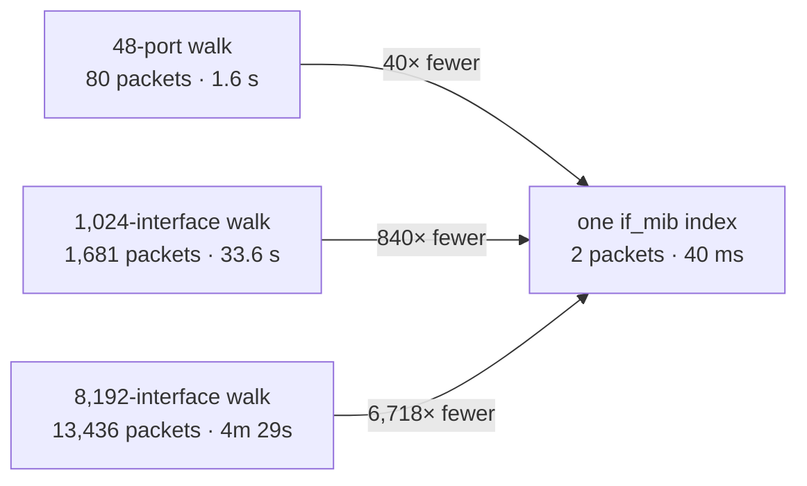

# snmp_exporter with an index parameter

A drop-in build of [prometheus/snmp_exporter](https://github.com/prometheus/snmp_exporter) v0.31.0. The binary, flags, port, config path, and Prometheus text are unchanged. A scrape can also name the SNMP instance it wants:

```text
/snmp?target=192.0.2.1&auth=public_v2&module=if_mib&index=42
```

Leave `index` off and the scrape walks the module the way upstream does. The same service that already calls the exporter and parses the text keeps working. Add `index` when the caller already knows which row it wants.

```text
/snmp?target=192.0.2.1&auth=public_v2&module=if_mib&index=1,3,6,10-20,1003
```

`index` is the instance suffix that follows a column OID, not a name. For IF-MIB and EtherLike-MIB that suffix is the ifIndex. A dotted suffix addresses a table with more than one integer index, such as `index=1.42`. Several rows go in one scrape as a comma-separated list, repeated `index` parameters, or an inclusive range. `10-20` is 10 through 20. The low end comes first: `20-10` and a range inside a dotted suffix (`1.10-1.20`) are HTTP 400. One scrape may name at most 256 suffixes. if_mib is about 42 GETs per index, 25 OIDs to a packet, so 256 indexes is a few hundred packets. A longer request is HTTP 400. An empty value is ignored. A hole in a range is still requested, the device answers noSuchInstance, and that row is absent from the text. A range fits ports numbered 1–48. Sessions numbered around 2000000000 stay a list.

## Why this stays a patch

prometheus/snmp_exporter treats the rows a module scrapes as configuration. [Issue 131](https://github.com/prometheus/snmp_exporter/issues/131) records the decision on passing indexes with the target:

> That's not something that I'm going to accept as modules should be static.

[Issue 176](https://github.com/prometheus/snmp_exporter/issues/176) was closed as the same question. What landed afterwards is a static `get:` list in the module, so a config file can name exact OIDs. Choosing the row on the scrape URL is the part that was refused. This repository keeps that parameter on an otherwise unchanged exporter, and it is not offered upstream as a pull request.

## Why

Interface tables are stored by column. `ifName.42` and `ifHCInOctets.42` are not one subtree, and the walk list in `snmp.yml` is a collapsed prefix such as `1.3.6.1.2.1.2`. Appending `.42` to that prefix does not mean ifIndex 42.

When `index` matches a metric, this build replaces that module's walks with SNMP GETs of `<column OID>.<index>`, plus the lookup columns (`ifName`, `ifDescr`, `ifAlias`) so the labels on the text stay the same. Scalars in the module are fetched at `oid.0`. Walks and dynamic filters in that module are skipped. The loaded configuration is not modified.

A module is narrowed only when it has columnar metrics with that index shape. `module=if_mib,system&index=42` narrows `if_mib` and still walks `system`, because `system` has no integer index. `ifStack`, which has two integer indexes, is included for `index=1.42` and left out of a one-component request.

The stock `if_mib` module walks every column of every interface. On a switch with a few dozen ports that is cheap. On a core router or a subscriber gateway, with thousands of subinterfaces or sessions, the walk is one GetBulk packet per 25 varbinds, sent one at a time.

These rows are from `make bench` against the simulator. The 20 ms column is the packet count times 20 ms, which is how long the walk waits when a device answers each packet in 20 ms. The full table, including the smaller module and a subscriber gateway, is in [bench/RESULTS.md](bench/RESULTS.md).

| Device | Module | Walk | One index |
| --- | --- | ---: | ---: |
| 48-port switch | `if_mib` | 80 packets, 1.6 s at 20 ms | 2 packets, 40 ms |
| Core, 1,024 interfaces | `if_mib` | 1,681 packets, 33.6 s at 20 ms | 2 packets, 40 ms |
| Core, 8,192 interfaces | `if_mib` | 13,436 packets, 4m 29s at 20 ms | 2 packets, 40 ms |
| Core, 8,192 interfaces | `if_index` | 3,608 packets, 1m 12s at 20 ms | 1 packet, 20 ms |

Times are packet count times 20 ms. The walk grows with the table. One index stays two `if_mib` packets.



The index scrape does not grow with the size of the table. On the 8,192-interface core, `if_mib` without `index` returned 335,873 PDUs and about 29 MB of Prometheus text. `index=134` (`ae0.100`) returned 42 PDUs. A subscriber device with sessions at ifIndex 2000008187 is the same shape: one GET, including for an ifIndex that is not a small integer.

## Other tables

`index` is the table's own instance suffix, not a special case for ifIndex. Any module whose indexes are integers is narrowed the same way. The suffix has to have one component per integer index. A module whose indexes are all addresses or names is scraped unchanged, because `42` does not address those rows.

| What you want | What to pass | Where it already works |
| --- | --- | --- |
| One interface, or a list of them | `index=42` or `index=1,3,10-20` | `if_mib` and `if_index` |
| The IPv4 row for that same interface | `index=42` | `ip_mib`. `ipv4InterfaceTable` is indexed by ifIndex |
| One chassis component | `index=5` | `cisco_device` rows indexed by `entPhysicalIndex`: power, sensors |
| A memory pool on that component | `index=5.1` | `cisco_device` `cempMemPool*`, indexed by `entPhysicalIndex` then `cempMemPoolIndex` |
| Junos operating table, four integer levels | `index=1.2.1.0` | `juniper` `jnxOperating*`, in the order contents, L1, L2, L3 |

`entPhysicalContainedIn` is a column on the component row, not another index component. The containment tree is that value: read it, then request `index` of the parent it names. `ifStack` is the same idea with two ifIndexes, `index=1.42`.

Once any metric in the module matches, the walks are dropped. Tables in that module whose index is not integers, such as `juniper`'s subscriber counter indexed by a name, are omitted from that scrape.

A few tables people group with "the interface" are a different index, so `index=42` does not mean ifIndex 42 there:

- ARP (`ipNetToMediaTable`) is ifIndex plus the address.
- A MAC forwarding entry is the MAC, and a VLAN-qualified one is VLAN id plus the MAC.
- A BGP peer is the peer address. Cisco's newer peer table adds address type and length in front of that address.
- A VLAN row is often the VLAN id. `index=100` on that table is VLAN 100.
- `cisco_device` also has image and CPU tables indexed by their own integers. `index=3` on that whole module asks for component 3, image 3, and CPU 3 together, because every one-integer metric matches. Split those into their own modules when the numbers mean different things.

Stock `snmp.yml` has no BGP, ARP, or bridge module. Generating one does not need a change here when the index is integers. An address index stays a walk, or a static `get:` of the exact OID.

## Smaller module

`if_index` is a module for one interface: name, alias, description, speed, admin and oper status, octet counters, and `dot3StatsDuplexStatus` (EtherLike-MIB `1.3.6.1.2.1.10.7.2.1.19`, the same ifIndex). Duplex is a gauge: 1 unknown, 2 halfDuplex, 3 fullDuplex. `ifOperStatus` and `ifAdminStatus` stay numeric gauges, matching the stock module.

In this repository the file is `examples/if_index.yml`. A release archive places it next to the binary as `if_index.yml`. The image has it at `/etc/snmp_exporter/if_index.yml` and does not load it unless you add the flag. The default command is still `--config.file=/etc/snmp_exporter/snmp.yml`.

Eleven columns fit in one GET. `ifInOctets` is the 32-bit counter. `ifHCInOctets` and `ifHCOutOctets` are the 64-bit counters. Without `index`, the module walks only those columns, still once per interface.

A row is kept when the instance suffix is exactly the metric's indexes. `dot3StatsDuplexStatus` has one integer index, so `1.3.6.1.2.1.10.7.2.1.19.15` is ifIndex 15 and `1.3.6.1.2.1.10.7.2.1.19.1.5` is not ifIndex 1. A longer suffix is skipped. The same rule applies to every module. An indexed GET still asks for the exact OID and nothing under it.

```text
--config.file=/etc/snmp_exporter/snmp.yml --config.file=/etc/snmp_exporter/if_index.yml
```

```text
/snmp?target=192.0.2.1&module=if_index&index=42
```

## Try it against the simulator

`sim/` is an SNMPv2c agent with a full ifTable, ifXTable, and duplex column. It is the stand-in for a device you cannot point at a lab router.

| Profile | What it publishes |
| --- | --- |
| `edge` | A switch: 1G ports, a few VLAN interfaces, one half-duplex port |
| `core` | Loopback, 100G ports, aggregate ethernet, then VLAN subinterfaces |
| `subscriber` | A few 100G uplinks and many `demux0.pp0` sessions at a high ifIndex |
| `uap` | `lo` at ifIndex 1, `ath0` at 15, `br-trunk` at 33. The duplex column is twelve OIDs of the form `...19.1.<n>`, with values 0, 1, 2, 3, 64, 7 and 128. A GET of `...19.1`, `...19.15` or `...19.33` is noSuchInstance |

```sh
make test
cd sim && go run . -profile edge -interfaces 48
```

The process prints one JSON line with `sample_index` and `sample_name`, then answers `public` on `127.0.0.1:11611`. Point the exporter at that address. The same URL works against real hardware; use the device's community and ifIndex.

`make bench` scrapes the simulator with and without `index` and rewrites [bench/RESULTS.md](bench/RESULTS.md). `make bench-check` is the smaller run used in CI (32 and 256 interfaces).

## Build

```sh
make test
make image
```

`make test` clones snmp_exporter v0.31.0, copies `exporter/` onto it, checks that the generated patch applies back to a clean tree, runs the tests, and loads the example module next to upstream `snmp.yml`.

The image listens on 9116, reads `/etc/snmp_exporter/snmp.yml`, and accepts the same flags, including `--web.config.file`. The version string ends in `-index`.

```sh
docker build -t snmp-exporter-index:v0.31.0 .
```

`VERSION` selects the upstream tag (`make test VERSION=v0.31.0`). The Go in `exporter/` and the anchors in `scripts/apply.py` are written against v0.31.0.

## Repository layout

| Path | What it is |
| --- | --- |
| `exporter/` | The change. `collector/index.go` decides which OIDs to GET, and skips an instance suffix longer than the metric's indexes. `index_param.go` is the HTTP wiring. |
| `scripts/apply.py` | Copies that Go onto an upstream tree. |
| `release/platforms.txt` | Image architectures and release binaries. |
| `examples/if_index.yml` | The smaller module. Release archives ship it as `if_index.yml` next to the binary. |
| `sim/` | The SNMP agent. |
| `bench/` | The measurement, and `make bench` which refreshes it. |

`make patch` writes `dist/snmp_exporter-<version>-index.patch`. That file is not kept in git. A tag publishes it on the GitHub release, next to the image, under that name. Apply it to a clean tree of the same upstream tag:

```sh
git clone --depth 1 --branch v0.31.0 https://github.com/prometheus/snmp_exporter.git
cd snmp_exporter
patch -p1 < /path/to/snmp_exporter-v0.31.0-index.patch
```

## Image and binaries

Pushes and pull requests to `main` run the tests and do not publish. Pushing a tag named for the upstream release, such as `v0.31.0`, publishes `ghcr.io/<owner>/<repo>:<tag>` and `:latest`, and attaches the patch, the binaries, and `sha256sums.txt` to the GitHub release. A manual run publishes `ghcr.io/<owner>/<repo>:sha-<commit>` and leaves `:latest` where it is.

`make image` builds `linux/amd64`. A published image is a manifest for the container platforms in `release/platforms.txt`: `linux/amd64`, `linux/arm64`, `linux/arm/v7`, `linux/ppc64le`, and `linux/s390x`. Each image carries an SBOM and build provenance in the registry. Package visibility follows the repository.

The same file lists the release binaries: those Linux architectures, plus `darwin/amd64`, `darwin/arm64`, and `windows/amd64` (tar.gz, and zip on Windows). Each archive contains the binary, upstream `snmp.yml`, `if_index.yml`, `LICENSE`, and `NOTICE`.

```sh
make binaries
git tag v0.31.0
git push origin v0.31.0
```

A scheduled workflow checks the latest snmp_exporter release once a day. When that tag is not already released here, it runs the tests against that tag and, if the patch applies and the tests pass, publishes the image and the binaries under the same version. A failure leaves the previous release in place and opens an issue. The anchors in `scripts/apply.py` are what make a moved upstream handler fail that run.

Counters are still rendered the way snmp_exporter renders them, including the 2^53 wrap. `--no-snmp.wrap-large-counters` is the upstream switch for a consumer that is not Prometheus.

See [CONTRIBUTING.md](CONTRIBUTING.md) for the upstream-bump path.
